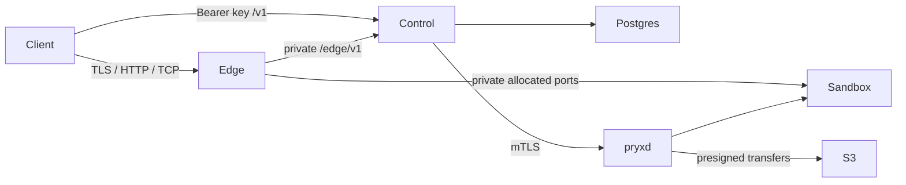

# Architecture

pryxd runs containers, restricted native process trees or agentOS WebAssembly VMs and owns
their local files. Control owns desired sandbox state,
placement epochs and the Postgres ledger, and reaches hosts only through pryxd's mutual-TLS API.
Edge is the public entry point: it polls routes, reads TLS SNI or HTTP Host (or uses a dedicated
TCP port), holds bytes while control wakes a sandbox, then relays them. Applications receive
no platform greeting and need no application-specific integration.

Make persists intent before asking a node, then places and boots (or provisions stopped).
Sleep keeps data and tries to suspend process memory; without that node feature it stops.
Wake resumes memory, boots from files, or restores a resting snapshot under a new epoch.
Rest first captures/uploads a snapshot, then releases local compute/data. Snapshot and fork
copy persistent files rather than memory. These verbs preserve state deliberately; delete
removes data and snapshots too.

| Tier | Retained resources | Wake |
| --- | --- | --- |
| Suspended | Memory, local disk, node reservation | Resume process memory |
| Stopped | Local disk and placement | Boot image from files |
| Resting | Object-store snapshot | Place, download, restore, boot |

Prices come from operator/provider configuration, never product constants. Suspension still
uses memory; stopped sandboxes still use local disk; resting copies use store space and transfer
requests. XFS reflink shares unchanged blocks; other filesystems may require a full copy.
The container tier fixes capabilities, filesystem mounts, network rules and allowed image prefixes
through host policy. The process tier uses the bundled userland, Landlock, seccomp, rlimits and
sampled resident memory without creating namespaces; its weaker boundary is described in
[process-tier.md](process-tier.md). The wasm tier uses a virtual kernel with WebAssembly and V8
in a shared unprivileged sidecar; SQLite and the explicit data mount survive recreation, while
processes and terminals end on sleep. Its limits and API mapping are in [agentos.md](agentos.md);
[tiers.md](tiers.md) compares all three. Placement enforces the requested isolation tier. A sandbox
request cannot loosen host policy. MicroVMs are not advertised. Workload ports are private; only
configured control/edge sources may dial them.

An epoch names one placement. Every mutating node request carries blocklyd-epoch; older handles
cannot affect a newer copy. Moves fence and retire the old copy, and the edge closes connections
from older epochs. The control execution lease permits autonomous restart only while current;
its expiry does not stop an already running sandbox. Operator-confirmed loss remains necessary
for failover when the optional store lease is off.

| Failure | pryx behavior | Caller sees |
| --- | --- | --- |
| Daemon crash | Containers continue; the owned wasm worker stops, retaining files for a fresh control ensure | Operations wait/fail; data stays |
| Docker restart | live-restore keeps containers; otherwise report stopped/crashed | Unavailable operations until recovery |
| Host reboot | Resume only after control authorizes | Temporary interruption |
| Host loss / partition | No timer creates another running copy | Unknown/unavailable; operator fences before rebuild |
| Control / Postgres outage | Running sandboxes continue; no new decisions | API operations fail or wait |
| S3 outage | Keep local data/copies; rest/rebuild waits | Operation unavailable, local copy retained |
| Disk floor | Refuse writes/creates needing room | insufficient_disk; running work remains |
| Lost exec reply | Keep durable uncertain request identity | operation_unknown; inspect before new key |
| Edge route change | Apply incrementally; close stale epoch connections | Reconnect to current copy |
| Edge dies | Sessions age out; other edges continue | Connections through that edge close |
| TTL expires | Access refuses immediately; upkeep deletes | gone |

The node protocol keeps its original v1 wire/on-disk names. Rust generates node OpenAPI;
Zod generates public and edge contracts; clients and documentation are checked for drift.
Control's durable create identity survives retries, while uncertain execs are never replayed
blindly. Secrets are excluded from views/events and node digests, and API keys are hash-only.
See protocol.md for exact node semantics, operations.md for recovery and edge.md for measured
client wait bounds. All Docker/end-to-end claims belong to actual CI runs, not the diagrams.
